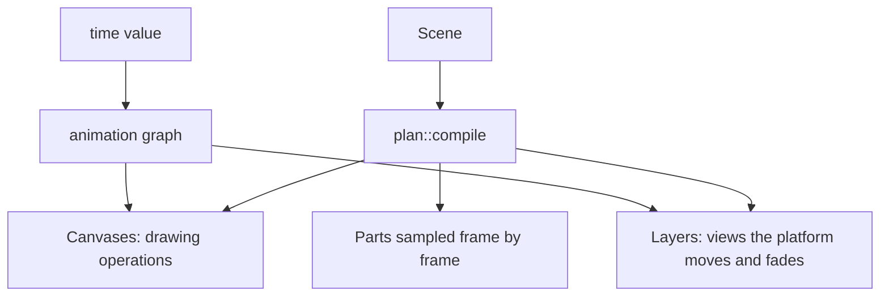

The player compiles a scene once into a plan: canvases whose drawing operations take their numbers and
colors from nodes of NSH's animation graph, and layers (views) the platform moves and fades. Playing moves one
time value; the graph computes every property from it on the UI thread. What the graph cannot express is
sampled frame by frame on the engine thread, that part alone.



## Time, easing and transforms

- **One time value drives the scene.** Playing is a linear timing of it from the segment's start to its end;
  each property is an interpolation of it. A track whose segments share an easing is one interpolation;
  segments of different easings share a warped time; overshooting easings (Back) add each segment's change.
  A track that repeats (loops of different lengths over the timeline they share) is one repetition read
  modulo its period.
- **Transforms** are canvas transforms of animated values; motion paths are lookups of the path sampled by
  length; animated matrices animate their decomposition; skews are sampled.
- **Groups that only move or fade** are layers the platform moves and fades: their content is drawn once, in
  the group's own lengths, and never again as the group moves.

```example
demo: moving-layers
height: 220
caption: A badge turning and growing along a path, and a card fading: layers, drawn once.
```

## Outlines, trims and dashes

- **Morphs.** A path morphing between keyframes of the same commands is a track per coordinate. One morphing
  between different commands switches halfway, as the reference renderer does: a copy of the shape for each
  run of the same commands, up to 32.
- **Stars and elliptical corners** have their points sampled over time (at least 120 times a second), each
  coordinate a lookup of the time.
- **Trims.** Where only one end of the drawn part moves (drawing on or off), the part is a dash pattern as long
  as the outline, moved along it. Where both ends move (spinners, Figma's path trims), the part is a path of
  its own whose points the graph moves, cut from lookups of the outline sampled by length.
- **Dash patterns** that move are such parts, one per dash, each going round the outline: up to 256 at once.
  Round a circle or an ellipse each dash is an arc between two angles the graph moves, a few nodes a dash
  instead of a moving point for every point of the part, so a ring of a hundred dashes starts at once.

```example
demo: trims
height: 220
caption: Trims of a rectangle and an arc, both ends moving, on the graph.
```

## Gradients

NSH's canvas gradients are still, so a gradient whose ends move is a still one placed by a transform the graph
moves. One whose colors change is its keyframes' gradients faded into one another. A linear gradient whose
stops move (Figma's shines) is a gradient between each two stops, in bands the graph moves. Stops that move
while their colors change, or change in number, are gradients sampled over time and faded into one another.

## Masks and clips

Masks of opaque shapes are clips of their outlines. Soft masks (partly transparent shapes, luminance,
chained mattes) draw the content on a canvas of its own and take away what the mask does not show
(`destination-out`, which every platform composites alike):

| Mask | How it plays |
|---|---|
| One shape, intersected with or subtracted from by others | A product of the shapes, every edge drawn once |
| One whose content moves as a whole at most | An image of what it hides, as the reference renders it, moved by the graph |
| One whose shapes change | The graph's, region by region of the plane its shapes cut (up to four solid shapes) |

## Shadows and blurs

- **Drop shadows** are cast by the group's casters: its content compiled again as a silhouette, in a layer
  under the content. A still shadow hidden under the content is drawn in place and cut out; a moving or
  see-through one is cast from casters past the view; a group that turns or scales casts in its own lengths.
  Moving blurs fade between still ones (up to ten).
- **Shadows the canvas cannot cast** from drawing operations (content that casts shadows itself, is masked,
  or spans several canvases) are cast by an image of the content's alpha, which still moves, turns and fades.
- **Inner shadows** are a canvas over the content: the silhouette in the shadow's color, less the silhouette
  moved and blurred.
- **Blurs** are images the reference renderer makes: once where they do not move, frame by frame where they do,
  kept for when the loop comes round. A part whose images take long to make is made less often, each held a few
  frames, so that making them takes a quarter of the time at most.

```example
demo: moving-shadows
height: 220
caption: Shadows whose offsets, colors and blurs move, on content that turns.
```

## Color effects, patterns and text

- **Color effects** (CSS and SVG color filters; Lottie's tint, fill, tritone, levels and color overlay) recolor
  each paint inside the group: colors, gradient stops, text, images and shadows. Moving effects become color
  tracks.
- **Pattern fills** clip to the outline and draw their tiles of still content, each moved into place (up to 256
  tiles).
- **Live text** is one `fillText` per line in the platform's fonts, placed, sized and colored by the graph.
  The platform's fonts are not the reference renderer's, so glyphs differ a little.

## Sampled frame by frame

What the graph cannot express is sampled on the engine thread instead, in a canvas of its own beside the
rest: more than 256 moving dashes, outlines of more than 32 different commands, paths switching commands more
than 31 times (Lottie's merge paths, baked at every frame), and shadows of moving content the canvas cannot cast.
Sampled parts that hold effects or soft masks are drawn as the reference renderer draws them. The reasons are
logged at info level:

```text
VectorAnimation: a part sampled frame by frame (a shape whose commands change many times)
```

These parts take their time from the graph: each frame they read the value the rest of the scene plays from, so
they stay with it, within a frame or two, however late the engine's own frames begin (a clock of their own
began with the engine's first frame, not with the graph, and on the web they ran a fifth of a second and more
behind the rest). When a run ends they rest on its last frame.

:::info Approximations
Figma's knock-outs and hard silhouettes count any coverage of a pixel where the canvas counts coverage, which
leaves a faint ring on edges between pixels. A mask whose overlapping see-through shapes change can show a
faint seam along edges inside it.
:::

## Next

[Platforms](./platforms.md) for how close each platform comes to the reference renderer; [Examples](./examples.md)
for every scene live.
