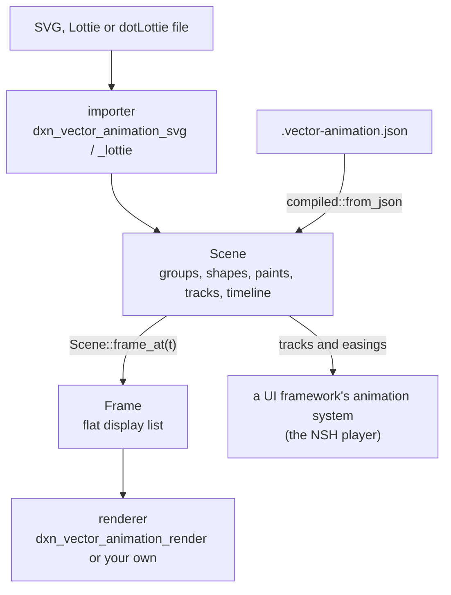

Every animation takes the same path: an importer reads the file into a `Scene`, and from there a renderer either samples the scene into frames or hands its tracks to an animation system of its own. Nothing after the importer knows which format the file was.



## Importers

Both importers have the same three functions:

| Function | Does |
|---|---|
| `sniff(data: &[u8]) -> bool` | Whether the bytes look like the importer's format (cheap, reads the start) |
| `read(data) -> Result<Import, Error>` | Reads with the default `Limits` |
| `read_with(data, &limits) -> Result<Import, Error>` | Reads within your `Limits` |

A program that takes any file sniffs first. This is the order the CLI and the NSH player use, a compiled scene first:

```rust
use dxn_vector_animation::{Error, Import, Limits, compiled};

/// Reads a compiled scene, a Lottie file or an SVG, whichever `data` is.
fn import(data: &[u8], limits: &Limits) -> Result<Import, Error> {
    if compiled::sniff(data) {
        let scene = compiled::from_json(data, limits)?;
        return Ok(Import { scene, warnings: Vec::new() });
    }
    if dxn_vector_animation_lottie::sniff(data) {
        return dxn_vector_animation_lottie::read_with(data, limits);
    }
    if dxn_vector_animation_svg::sniff(data) {
        return dxn_vector_animation_svg::read_with(data, limits);
    }
    Err(Error::Invalid("neither SVG, Lottie nor a compiled scene".into()))
}
```

`compiled` needs the core's `serde` feature. The importers parse the whole file, convert it, and check the finished scene against the limits once more (`Scene::check`) before returning it.

## Errors and warnings

A file either reads or it does not. `Error` has three variants:

| Variant | When |
|---|---|
| `Error::Limit { what, limit }` | The file is over one of the [limits](./limits.md): `the file exceeds the limit of 3600 seconds of timeline` |
| `Error::Invalid(message)` | It is not a valid document of its format: broken XML or JSON, a Lottie file without `fr` |
| `Error::Unsupported(message)` | It uses something the scene cannot represent at all: a compressed `.svgz`, a ZIP64 dotLottie archive |

Everything else reads, and what the scene leaves out or approximates is a warning: `Import::warnings` is a `Vec<String>`, one message for each kind of thing left out, such as `<foreignObject> is left out` or ``the layer effect `Glow` is left out``. The importers report what they leave out instead of dropping it silently, so a pipeline can decide: show the warnings to the designer, or fail a build with `vector-animation validate --strict`.

## Two ways to play

### Sample frames

`Scene::frame_at(t)` evaluates every property at `t` and flattens the tree into a `Frame`: fills, strokes, images and text with their matrices, between layer pushes and pops for opacity, blending, clips, masks and effects. A renderer only has to draw that list. The reference renderer draws these lists; a thumbnailer, a video export or a golden test needs nothing else, and a renderer without an animation system of its own plays a scene with one `frame_at` per display frame. [Frames and rendering](./frames-and-rendering.md) covers the list.

### Drive the tracks

Every animatable property in the scene is an `Animated<T>`: a constant, or keyframes on the timeline with an easing per segment. A UI framework with its own animation system can read those keyframes once and let its own clock play them, with no per-frame work in Rust. Here are the opacity tracks of the Figma fixture:

```rust
use dxn_vector_animation::{Animated, Group, Node};

/// Prints each group's opacity: a constant, or its keyframes.
fn opacities(group: &Group, depth: usize) {
    let name = group.id.as_deref().unwrap_or("(group)");
    let indent = "  ".repeat(depth);
    match &group.opacity {
        Animated::Static(value) => println!("{indent}{name}: {value}"),
        Animated::Track(track) => {
            for key in &track.keyframes {
                println!("{indent}{name}: {} at {} s, then {:?}", key.value, key.time, key.easing);
            }
        }
    }
    for child in &group.children {
        if let Node::Group(child) = child {
            opacities(child, depth + 1);
        }
    }
}
```

```text
(group): 1
  Button: 0 at 0 s, then CubicBezier { x1: 0.5, y1: 0.0, x2: 0.5, y2: 1.0 }
  Button: 1 at 1 s, then Linear
  Button: 1 at 2 s, then Linear
  One_tile: 1
  (group): 1
```

The NSH player in this repository works this way: it compiles a scene into canvases whose numbers and colors are nodes of NSH's native animation graph, and plays the whole scene by moving one time value on the UI thread. What the graph cannot express it samples frame by frame on the engine thread, that part alone. See [The NSH player](./nsh-player.md).

:::note Time is not wrapped
`frame_at(t)` samples exactly `t`. Looping, ping-pong, playback rate and segments are the player's: map the wall clock to scene time first, as shown in [The timeline](./scene-model.md#the-timeline).
:::

## WebAssembly

The core and both importers build for `wasm32-unknown-unknown`: they use no threads, files or system fonts, and take bytes, not paths. CI checks it on every pull request and push to `main`:

```bash
cargo check -p dxn_vector_animation -p dxn_vector_animation_svg -p dxn_vector_animation_lottie --target wasm32-unknown-unknown
```

A web player that only loads [compiled scenes](./compiled-scenes.md) needs the core alone, with `serde`: the SVG and Lottie readers, the CSS and expression interpreters stay out of the bundle. The reference renderer is not part of that check; it sets text in the system's fonts, which a WebAssembly build does not have.

## The boundaries

- The core crates (`dxn_vector_animation`, `_svg`, `_lottie`, `_render`, `_cli`) depend on no UI framework. CI fails when any of them pulls in an NSH crate, and a plain `cargo build` in the repository builds no NSH.
- Importers read untrusted documents: every size, count and depth they take is bounded by `Limits`.
- A player maps scenes and holds no format code: what it needs from a format is added to the scene model, so every player gets it.

Next: [The scene model](./scene-model.md), or the inputs: [SVG](./svg.md) and [Lottie](./lottie.md).
